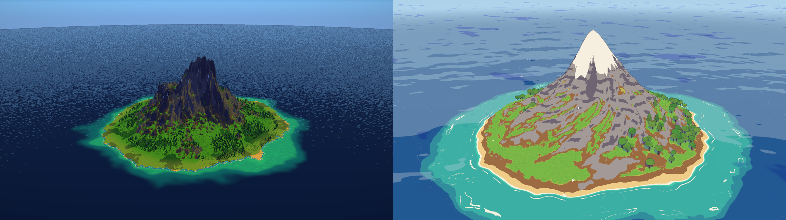
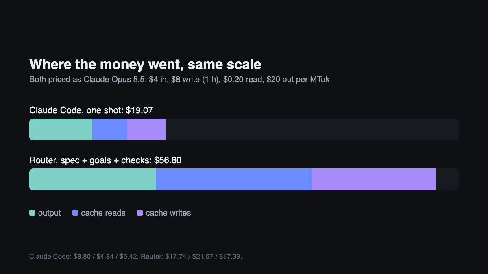
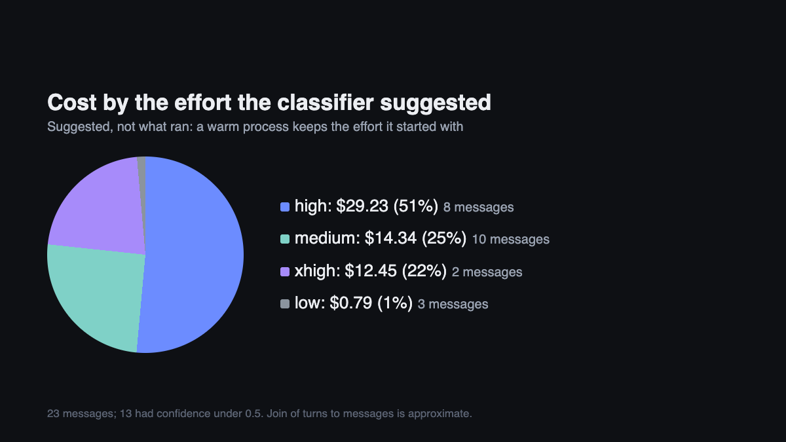

# Island weather diorama: one shot vs spec

One prompt, run two ways on 2026-10-14. Claude Code as a one shot, and a
router I'm building, with the prompt as a spec with goals and checks. The
router run cost about three times as much and I judged its output better.

## The two builds

[Watch both side by side](videos/side-by-side.mp4) (22 s), or each alone:
[Claude Code](videos/claude-code.mp4), [router](videos/router.mp4). The
labels in the videos show each run's cost and time. Each is a short orbit of
the finished page, not a recording of the build.

Both frames are at each page's default camera distance, with the control
panels hidden, the same time of day and the same seed. More angles:
[overhead](images/both-scenes-overhead.png) and
[side-on](images/both-scenes-angle.png).

The prompt asks for a cel-shaded look: "a toon ramp of three or four hard light
bands", ink outlines drawn in a post-process pass, and "one limited,
hand-picked palette", in the manner of The Wind Waker. Flat colour bands and
outlines are what it asks for, not a rendering fault.

## Result

| | Claude Code | Router (spec, goals, checks) | Ratio |
|---|---|---|---|
| Cost | $19.07 | $56.80 | 3.0x |
| Output tokens | 440k | 887k | 2.0x |
| Cache reads | 24.2M | 108.4M | 4.5x |
| Cache writes | 678k | 2.18M | 3.2x |
| Time | 1 h 12 m API, 1 h 47 m wall | about 4.5 h of activity, 14 h elapsed | |
| Models | Opus 5.5 (xhigh) | Opus 5.5 on 31 of 33 turns, Sonnet 5.5 on 2 | |
| Lines changed | 2,520 added, 1 removed | not recorded | |

Both priced as Claude Opus 5.5: $4 input, $8 cache write (1 hour), $0.20 cache
read, $20 output per million tokens.

Most of the extra cost is cache: long contexts read again and again, and
written. One turn in the router run read 38.3M tokens by itself.

## What I take from it, and what I don't

- The router cost about three times as much and I judged the output better.
  I can't say which part made the difference: the spec, the goals and checks,
  or the longer run.
- Cache reads and writes, not output, were most of the extra cost.
- The router's model switching barely mattered: 31 of 33 turns ran on Opus.
- The router suggests an effort per message, but a warm Claude Code process
  keeps the effort it started with. The effort that actually ran is not
  recorded, so I make no claim that dynamic effort helped or hurt.

## Caveats

- **One run each, not a controlled test.** The setups differed, and the router
  run had one extra line telling it where to write the file. It produced
  `index.html`, not the `island.html` the prompt names.
- **Subscription.** Both runs used a subscription. The dollar figures are what
  the same use would cost on metered API keys.
- **The router's cost-by-cause breakdown is unreliable.** Its records are one
  row per turn, and a long turn that wrote over 100k tokens is labelled a
  "compaction" (the score says $11.70). Treat the totals as right and that
  label as wrong.
- **Claude Code writes at the 1-hour cache rate.** That is inferred: its total
  only adds up at that rate, on one session.
- **Lines changed** is missing for the router run.
- **The router isn't public.** The router run can't be reproduced from this
  repo. The Claude Code run can.

## Files

| Path | What it is |
|---|---|
| `prompt.txt` | The prompt, as plain text |
| `settings.txt` | Models, effort, cache settings and pricing for both runs |
| `claude-code/island.html` | The Claude Code build |
| `router/index.html` | The router build |
| `videos/` | Both builds side by side, and each alone |
| `images/` | The charts used above |
| `data/claude-code.session.txt` | Claude Code's session summary, and how it adds up |
| `data/router.score.txt` | The router's score output (two lines naming internal task messages removed) |
| `data/router.usage-by-turn.csv` | Tokens per turn for the router run |
| `data/router.effort-by-message.csv` | The effort suggested for each message (message text removed) |
| `data/summary.json` | The figures used in the charts |

## Reproduce the Claude Code run

Give `prompt.txt` to Claude Code on Opus 5.5 at xhigh effort, in an empty
folder, and ask for one `island.html`. Compare the session summary with
`data/claude-code.session.txt`. Both builds load Three.js from jsDelivr (the
Claude Code build uses 0.160.0, the router build 0.170.0), so they need a
network connection to open.
