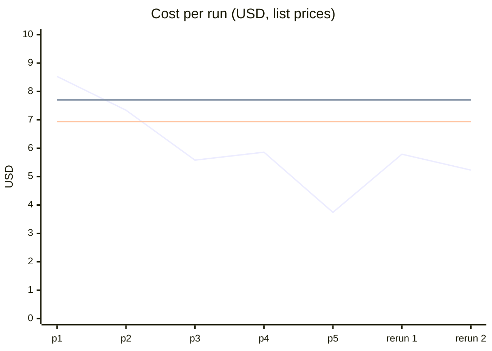

# Pineapple runs

The challenge started with [this tweet](https://x.com/vib3coded/status/2110744617918304744). These are Opus builds of the same [`spec.md`](spec.md), a WebGPU soft-body jelly ring. Each build was made with nullrouter at a later commit, so the spec stays the same and only nullrouter changes. The record shows what each change to nullrouter did to the cost of building it.

## Summary

The three nullrouter runs that finished from pineapple-5 onward averaged **$4.92**, with a range of $3.74–$5.79. Every one of them cost less than both baselines:

| Compared with | Average | Most expensive run ($5.79) | Cheapest run ($3.74) |
|---|---|---|---|
| Opus high in plain Claude Code ($7.70) | 36% cheaper | 25% cheaper | 51% cheaper |
| The tweet's build ($6.94) | 29% cheaper | 17% cheaper | 46% cheaper |

The comparison isn't entirely like for like. The $7.70 run included browser checks, and the nullrouter runs never opened a browser, so some of the gap is less work rather than cheaper work.

## Cost per run

The falling line is the nullrouter runs. The two flat lines are the baselines: Opus high in plain Claude Code ($7.70, top) and the tweet's build ($6.94). The stopped rerun is left out, because it never finished.

## Runs

| Run | Ran | nullrouter at | Cost | Tokens | Turns | Read:written | Cache reads | Spec size | Report |
|---|---|---|---|---|---|---|---|---|---|
| pineapple-1 | 15 Oct 19:31–20:25 | `87cc47d` | $8.53 | 9.3M | 116 | 47:1 | $1.72 | 11.1 KB | [report](pineapple-1/REPORT.md) |
| pineapple-2 | 16 Oct 00:41–01:15 | `c111ebb` | $7.34 (−14%) | 10.7M | 72 | 61:1 | $2.07 | 8.8 KB | [report](pineapple-2/REPORT.md) |
| pineapple-3 | 16 Oct 12:44–14:16 | `0c377fc` + plan first | $5.58 (−24%) | 3.7M | 32 | 23:1 | $0.67 | 5.0 KB | [report](pineapple-3/REPORT.md) |
| pineapple-4 | 16 Oct 20:01–20:29 | `5ff22fc` | $5.86 (+5%) | 3.9M | 26 | 21:1 | $0.70 | 3.6 KB | [report](pineapple-4/REPORT.md) |
| pineapple-5 | 16 Oct 23:59–17 Oct 00:16 | `8ef10a9` | $3.74 (−36%) | 2.9M | 32 | 27:1 | $0.53 | 2.7 KB | [report](pineapple-5/REPORT.md) |

Times are local (+02:00). Costs are the list prices nullrouter recorded for each call; the runs themselves were on a subscription.

From pineapple-1 to pineapple-5, cost fell 56% and tokens fell 69%.

The runs don't all do the same work, so some of the drop is less work rather than cheaper work. pineapple-1 ran headless WebGPU checks, while pineapple-2 to -5 never opened a browser. See [`CHANGES.md`](CHANGES.md) for the details.

### Reruns after pineapple-5

These are further nullrouter runs of the same spec, made after pineapple-5 to check that its cost holds. Each has a summary row only, with no folder, report or score copy.

| Run | Cost | Notes |
|---|---|---|
| rerun 1 | $5.79 | finished |
| rerun, stopped | about $6 | stopped before it finished; the figure was read off the session before the stop; not in the average |
| rerun 2 | $5.23 | finished |

## Baselines

These builds were made without nullrouter. They have no nullrouter score data, so the only numbers are the ones below.

| Build | Cost | Notes |
|---|---|---|
| [The tweet](https://x.com/vib3coded/status/2110744617918304744) | $6.94 | the author's own figure |
| Opus high in plain Claude Code | $7.70 | 28 requests, 43m 13s wall time (28m 56s API), 1,580 lines added. Opus: 58 input, 197.4k output, 4.4M cache read and 359.2k cache write tokens. Haiku cost $0.0003. The run included browser checks. |

## In this repo

- [`CHANGES.md`](CHANGES.md): which nullrouter commits went in before each run, what moved, and the changelog for each set of commits.
- `pineapple-N/`: each run's built page (`pineapple-N.html`), its sources, `REPORT.md` and `score.svg`.
- [`RECORD.md`](RECORD.md): how to record the next run.
